# Kubernetes Continuous Delivery Using Argo CD (GitOps)


[](https://github.com/sachin24284/k8s-argocd-cd/actions/workflows/ci.yaml)

A hands-on **GitOps** project: I built **Argo CD v3.7.0 from source**, deployed it on a local **Kubernetes** cluster, and used it to deploy applications automatically from this Git repository. Every change goes through Git, and Argo CD keeps the cluster matching it.

## Project Highlights

- **Built Argo CD from source** into a Docker image with a multi-stage build (Node.js UI + Go binaries), then installed that custom image on Kubernetes.
- **Declarative installs with Kustomize:** swapped the image, fixed the image pull policy, and patched config maps (local user and RBAC) without editing upstream manifests.
- **App-of-apps pattern:** one `root` Application creates the AppProject and ApplicationSet from Git.
- **ApplicationSet:** one template generates the **dev** and **prod** applications automatically.
- **Environment overlays with Kustomize:** dev runs 1 replica, prod runs 2, from the same base manifests.
- **Helm:** deploys a local chart and a public chart from a Helm repository.
- **Deployment control:** PreSync and PostSync **hooks** and **sync waves** for ordered rollouts.
- **Self-healing and drift detection:** manual cluster changes are reverted automatically to match Git.
- **Least privilege:** an AppProject limits allowed repositories and namespaces, and a read-only user is configured through RBAC.
- **Troubleshooting:** solved real environment issues (WSL2, Docker Desktop, image pull policy, repo access) during setup.

## How it works



1. **Push:** I edit YAML in VS Code and push to GitHub.
2. **Read:** Argo CD's repo server reads the repo and renders the manifests (Kustomize or Helm).
3. **Apply:** the application controller compares Git with the cluster and syncs the difference.
4. **Report:** live state is reported back, and drift is reverted when self-heal is on.
5. **Images:** the Argo CD image and the demo app image are built locally with Docker and run in the cluster.
6. **Observe:** the Argo CD web UI (`localhost:8080`) and `kubectl` show status, history and health.

## Screenshots


## Tools and technologies

| Category | Tools | Used for |
|---|---|---|
| GitOps / CD | **Argo CD 3.7.0** | Continuous delivery, sync, self-heal, UI |
| Containers | **Docker**, Docker Desktop, WSL2 | Building and running images |
| Orchestration | **Kubernetes** (Docker Desktop cluster), `kubectl` | Running the workloads |
| Config management | **Kustomize**, **Helm** | Overlays for dev/prod, charts |
| Source control | **Git**, **GitHub**, GitHub Desktop | Single source of truth |
| Languages | **Go** (Argo CD), TypeScript/React (Argo CD UI), YAML, PowerShell, Bash | Build, config, automation |
| Web server | **nginx** | Demo application |
| Editor | **VS Code** (YAML, Docker, Kubernetes extensions) | Development |

## Repository structure

```text
k8s-argocd-cd/
├── app-src/hello-web/     demo web app (nginx) + Dockerfile
├── gitops-repo/           what Argo CD watches
│   ├── bootstrap/         root Application (applied once)
│   ├── argocd-config/     AppProject, ApplicationSet, extra apps
│   ├── workloads/         hello-web (Kustomize base + dev/prod overlays), hooks demo
│   └── charts/            local Helm chart
├── platform/              Argo CD install (Kustomize: image swap + config patches)
├── docs/                  guide and diagrams
├── scripts/               helper scripts (bash)
└── .vscode/               recommended extensions and tasks
```

## Quick start (Windows PowerShell, Docker Desktop with Kubernetes enabled)

```powershell
# 1. Put the Argo CD source (v3.7.0) in ./argo-cd-master, then build the image
docker build -t argocd-custom:3.7.0-local .\argo-cd-master

# 2. Build the demo app image
docker build --build-arg VERSION=1.0.0 -t hello-web:1.0.0 .\app-src\hello-web

# 3. Install Argo CD (uses the custom image)
$t = Get-Content -Raw .\argo-cd-master\manifests\install.yaml
$t = $t -replace 'imagePullPolicy: Always','imagePullPolicy: IfNotPresent'
[System.IO.File]::WriteAllText("$PWD\platform\argocd-install\install.yaml", $t, (New-Object System.Text.UTF8Encoding $false))
kubectl create namespace argocd
kubectl apply -n argocd --server-side --force-conflicts -k platform/argocd-install

# 4. Open the UI at https://localhost:8080 (user: admin)
kubectl port-forward svc/argocd-server -n argocd 8080:443

# 5. Bootstrap: Argo CD now creates everything else from this repo
kubectl apply -f gitops-repo/bootstrap/root-app.yaml
kubectl get applications -n argocd
```

## Try the GitOps loop

- **Self-heal:** `kubectl -n hello-prod scale deploy hello-web --replicas=5`, and Argo CD sets it back to 2.
- **Change through Git:** edit the replica count in `gitops-repo/workloads/hello-web/overlays/prod/kustomization.yaml`, push, and the cluster follows.
- **Promote a version:** build `hello-web:1.1.0`, change `newTag` in the dev overlay, push, and dev updates while prod stays on 1.0.0.

## Roadmap

- [ ] CI pipeline with **GitHub Actions** (build the image, push to a registry, update the image tag in Git)
- [ ] Test the read-only user and RBAC policies end to end
- [ ] Add Sealed Secrets or External Secrets for secret management
- [ ] Add monitoring with Prometheus metrics from Argo CD

## Author

**Sachin Barkade** - Cloud and DevOps engineer  
GitHub: [@sachin24284](https://github.com/sachin24284)

---

Argo CD is an open-source CNCF project. This repository uses an unmodified source snapshot to learn how it is built and deployed.

## Architecture



